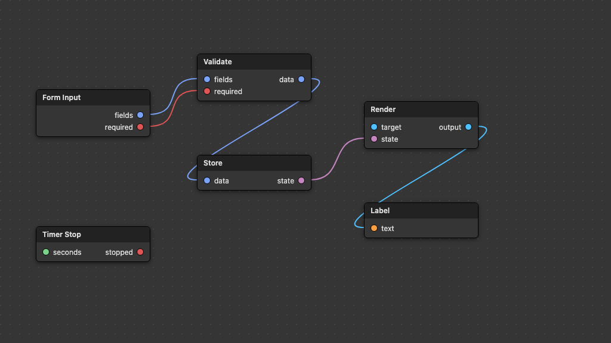

# Comfy UI

A minimal, composable UI framework for JavaScript.



The image is rendered from `demo/graph.html` by `scripts/render-thumbnail.sh`. It shows the node and graph components with placeholder nodes.

## Features

- Lightweight: no dependencies (except express for server)
- Simple component model
- CSS-in-JS ready
- TypeScript support planned

## Quick Start

```javascript
import { Button, render } from './src/ui/render.js';

const btn = Button({ 
  label: 'Get Started',
  onClick: () => alert('Hello!')
});

render(btn, document.getElementById('app'));
```

## Custom node: Timer Stop

Timer Stop is a comfy UI node that calls a stop function after a set number of seconds. Use it to stop a running job on a timer.

```javascript
import { createTimerStop } from './src/nodes/TimerStop.js';

const timer = createTimerStop({
  seconds: 30,
  onStop: () => console.log('stopped'),
});
timer.start();
// timer.cancel() prevents the stop
```

Current scope:

- The node only runs the callback you pass in. It is not connected to any image generator in this repo.
- Wiring it to a real image generation job means passing in that job's stop function.
- It has no ComfyUI integration yet. Running it inside ComfyUI needs that project's node API, which this repo does not implement.

## Development

```bash
npm install
npm run dev
```

## License

MIT
